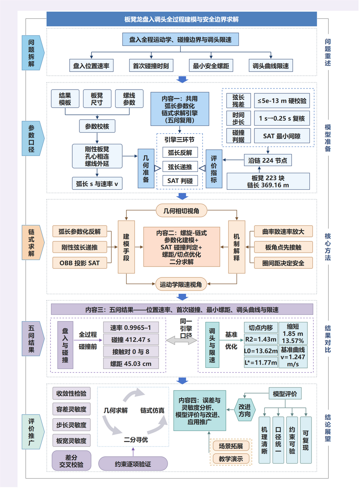

# “板凳龙”盘入调头全过程的运动学建模与安全边界求解

2024 年全国大学生数学建模竞赛 A 题的完整求解工程：可复现代码、计算结果、论文级图表与 Typst 排版论文。

## 主要结果

| 问题 | 结论 |
| --- | --- |
| 问题一 | 0–300 s、301 个时刻 × 224 个把手的位置与速率；弦长残差 $4.88\times10^{-13}$ m，速率 0.996478–1.000000 m/s |
| 问题二 | 首次碰撞时刻 $t^*=412.473800$ s，首个接触对为龙头板凳与第 8 节龙身板凳 |
| 问题三 | 最小螺距 $p_{\min}=0.450274$ m/圈（45.027 cm） |
| 问题四 | 标准 $S$ 形调头曲线 $L_0=13.621245$ m；切点内移后最短 $L^*=11.772919$ m（缩短 13.57%） |
| 问题五 | 放大系数峰值 $A_{\max}=1.603836$（第 6 节龙身、$t=14.50$ s），龙头最大速率 $v_{\max}=1.247010$ m/s |

## 核心思路

以弧长参数化的等距螺线为统一几何底座：

1. 用解析弧长函数 $G(r)=\frac r2\sqrt{r^2+k^2}+\frac{k^2}{2}\operatorname{arsinh}(r/k)$ 与牛顿反解得到任意弧长处的位姿，避免数值积分误差；
2. 把 224 个把手的位置化为一元弦长方程的串联求根（上一时刻解热启动 + 牛顿迭代 + 二分兜底）；
3. 速度由隐函数求导解析给出 $a_i=\frac{u_i\cdot T_{i-1}}{u_i\cdot T_i}$，无需差分近似；
4. 碰撞用 OBB + SAT 的**最小平移重叠量**（连续量而非布尔量）判定，使“首次碰撞”可以二分求根；
5. 调头曲线由“两弧与两螺线相切 + 两弧外切 + $R_1=2R_2$”化为一元二次方程解析求解。

## 目录结构

```
code/                  求解工程
  src.py               算法源（单元式脚本，唯一实现）
  A题_求解.ipynb        已执行的 Notebook（含全部输出与内嵌图）
  build_notebook.py    src.py → .ipynb
  run_notebook.py      执行 Notebook 并回写输出
  paper_figures.py     由 outputs/*.npz 重绘论文级矢量图
  outputs/             result1/2/4.xlsx、summary.json、validation.json、表格 csv
paper/                 Typst 论文工程（main.typ + sections/ + figures/）
  main.pdf             论文成稿（27 页）
figures/               分析级图表（17 组，PDF）+ 技术路线图（drawio/pdf）
figures_paper/         论文级图表（14 组，PDF）
reports/               建模分析、结果说明、验收三份报告
test/                  赛题与官方空白模板（仅保留 3 个空白 xlsx）
```

## 快速复现

依赖 Python 3.11+（本项目在 3.14.4 上验证），以及可选的 Typst 0.13+。

```powershell
py -3.14 -m pip install -r requirements.txt

cd code
py -3.14 build_notebook.py        # src.py → A题_求解.ipynb
py -3.14 run_notebook.py "A题_求解.ipynb"   # 约 3.5 min，写出 outputs/ 与 figures/
py -3.14 paper_figures.py         # 可选：重绘论文级图到 figures_paper/
```

编译论文：

```powershell
cd paper
typst compile main.typ           # 生成 main.pdf
```

## 技术路线



可编辑源文件：`figures/technical_roadmap.drawio`，内容来源：`figures/technical_roadmap.content.json`。

## 说明

- 附件 `test/A题/附件/result{1,2,4}.xlsx` 为赛题提供的**空白模板**，代码读取它确定输出表结构与节点标签；最终答案由本工程写入 `code/outputs/`。
- 赛题原文与官方格式规范未随仓库分发，请通过竞赛官方渠道获取。
- `code/outputs/*.npz` 为可重跑生成的中间数据，未纳入版本库。

## 许可

代码部分采用 MIT 许可证；论文、图表与报告的建议许可见 `LICENSE`。
